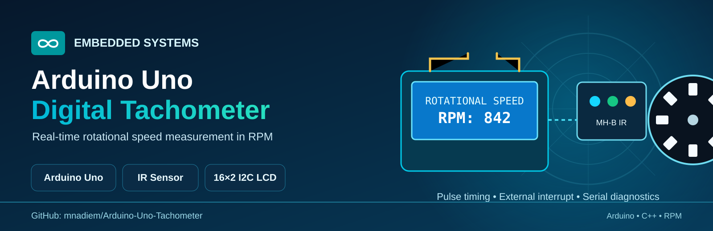

<div align="center">



# Arduino Uno Digital Tachometer

**Measure rotational speed in RPM with Arduino Uno, an MH-B IR sensor, and a 16×2 I2C LCD.**

[](https://www.arduino.cc/)
[](src/ArduinoUnoTachometer/ArduinoUnoTachometer.ino)
[](#how-it-works)

</div>

---

## Overview

This project measures the rotational speed of a rotating target in **revolutions per minute (RPM)**. An MH-B infrared obstacle-avoidance / line-tracking sensor module detects pulses as the target rotates. The Arduino Uno measures the time between pulses, calculates RPM, displays the result on a 16×2 I2C LCD, and reports measurements to the Serial Monitor.

The project has been demonstrated on **physical hardware** and in **simulation**.

## Demonstrations

- [Physical hardware video](Tachometer.mp4)
- [Simulation video](Tachometer%20Simulation%20Vid.mp4)

## Hardware

| Component | Details |
|---|---|
| Microcontroller | Arduino Uno (ATmega328P) |
| Sensor | MH-Sensor-Series (Flying-Fish) MH-B IR Obstacle Avoidance / Line Tracking Module |
| Display | 16×2 LCD with I2C backpack |
| LCD I2C address | `0x27` (configured in the sketch) |
| Sensor signal | Digital pin `D2` (external interrupt) |
| Pulses per revolution | `2` (adjust to match the physical target and sensor setup) |

## Circuit and Simulation

### Circuit diagram


### Simulation — measurement OFF


### Simulation — measurement ON


## How It Works

1. The IR sensor detects the rotating target and outputs digital pulses.
2. Arduino detects rising edges on `D2` using an external interrupt.
3. The interrupt routine records the microsecond timestamp and pulse period.
4. The main loop calculates RPM from the pulse period and configured pulses per revolution.
5. If no pulse arrives within the configured timeout, the displayed RPM returns to zero.
6. RPM is displayed on the LCD and periodically sent to the Serial Monitor.

The calculation is:

`RPM = 60,000,000 / (pulse period in microseconds × pulses per revolution)`

## Wiring

| Signal | Arduino Uno |
|---|---|
| IR sensor digital output | `D2` |
| LCD SDA | `A4` |
| LCD SCL | `A5` |
| LCD VCC / GND | Connect according to the LCD module specifications |
| IR sensor VCC / GND | Connect according to the sensor module specifications |

Confirm the pin labels on your actual modules before powering the circuit. Some I2C LCD backpacks use an address other than `0x27`.

## Requirements

- [Arduino IDE](https://www.arduino.cc/en/software)
- A compatible `LiquidCrystal_I2C` library

## Build and Run

1. Clone or download this repository.
2. Open `src/ArduinoUnoTachometer/ArduinoUnoTachometer.ino` in the Arduino IDE.
3. Install a compatible `LiquidCrystal_I2C` library.
4. Select **Arduino Uno** and the correct port.
5. Connect the sensor output to `D2` and connect the LCD over I2C.
6. Upload the sketch.
7. Open Serial Monitor at **9600 baud**.
8. Rotate the target and observe the RPM on the LCD and Serial Monitor.

## Serial Output

The sketch periodically reports the measured pulse period in microseconds and the calculated RPM.

## Measurement Notes and Limitations

- `PULSES_PER_REVOLUTION` must match the number of detected pulses per full revolution. An incorrect setting produces a proportional RPM error.
- The code uses an atomic snapshot when copying 32-bit values shared with the interrupt routine, avoiding torn reads on the Uno's 8-bit AVR CPU.
- The first detected edge establishes a timing reference; RPM is calculated after a subsequent edge provides a valid period.
- RPM is set to zero when pulses stop for longer than the configured timeout (`100,000 µs`). This timeout also limits the lowest continuously measurable speed.
- Sensor alignment, target markings, ambient light, and pulse quality can affect readings. No specific accuracy or maximum RPM is claimed without calibration and testing.

## Repository Structure

```text
.
├── assets/
│   └── tachometer-cover.png
├── docs/
│   └── wiring-and-setup.md
├── src/
│   └── ArduinoUnoTachometer/
│       └── ArduinoUnoTachometer.ino
├── Tachometer Circuit.png
├── Tachometer Simulation OFF.png
├── Tachometer Simulation ON.png
├── Tachometer Simulation Vid.mp4
└── Tachometer.mp4
```

## License

No license is currently specified. Unless a license is added, the source code remains subject to default copyright rules.
